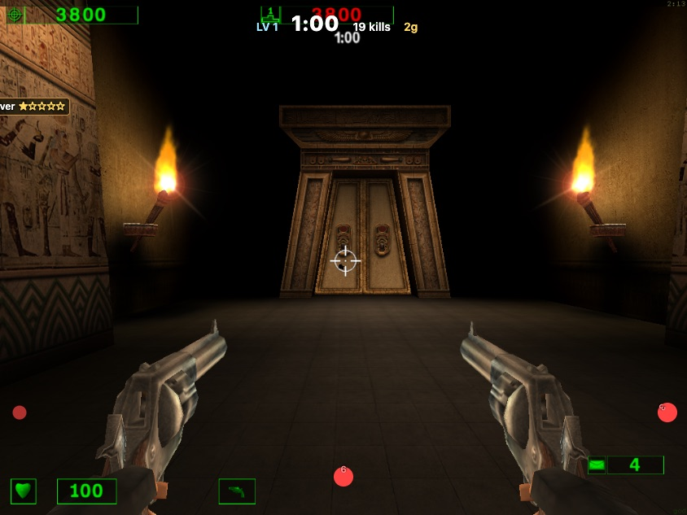

# Serious Sam in the browser

*Serious Sam: The First Encounter* (Croteam, 2001) running in Chrome: the original Serious Engine 1
source compiled to WebAssembly, drawn with WebGL2 or WebGPU, with Web Audio sound, touch and gamepad
controls, saves that survive a reload, and co-op between browsers. On top of the classic campaign
sits a Rust mod layer that adds a roguelike *Survivors* mode and bots.

You bring the game data: the free official demo works out of the box, the full game comes from your
own retail copy (Steam, GOG or CD).

> Not affiliated with or endorsed by Croteam or Devolver Digital. This repository contains the
> engine source Croteam released under the GPL, and none of the game's data.



## Features

| | |
|---|---|
| **The whole engine** | Serious Engine 1.10 as released, patched minimally under `__EMSCRIPTEN__`. The engine runs in a worker and the page draws its GL calls, so the page never blocks. A single-threaded build (JSPI) runs where cross-origin isolation isn't available. |
| **Rendering** | WebGL2 through our own OpenGL 1.x shim, or WebGPU (`?gfx=webgpu`). Automatic resolution and quality (`?quality=auto`), FXAA and sharpening (`?post=fxaa,sharpen`). |
| **Controls** | Mouse and keyboard with pointer lock. Touch sticks on phones and tablets. Gamepads with aim assist and bullet magnetism (`?aimassist=0-3`). DualSense gyro aiming over WebHID (`?gyrosens=2`). |
| **Saves** | Saves, settings and the player profile live in OPFS or IndexedDB and survive reloads. |
| **Co-op** | Browsers play together through a small Rust "virtual LAN switch" (`?room=name&host=1`, others `?room=name`), with a lobby page and optional WebRTC data channels. |
| **Serious Survivors** | A roguelike mode written in Rust (`?mode=survivors`): endless waves, level-up cards, auto-firing guns, chests, threat markers and hit direction. |
| **Bots** | AI players that join a level, walk a navigation graph, open doors and fight (`?bots=3`). |
| **Hosting** | `tools/package.sh` makes one static folder any web host can serve: a landing page picks the threaded or single-threaded build. |

## What you need

- **Toolchain:** macOS or Linux with [emsdk](https://emscripten.org/docs/getting_started/downloads.html)
  7.0.0, CMake, Ninja, Python 3, Node.js 20+, and Rust ([rustup](https://rustup.rs)) stable plus
  nightly with `rust-src` (the mod is built for `wasm32-unknown-emscripten`).
- **To play:** a current Google Chrome. The threaded build needs a page served with cross-origin
  isolation, which `tools/devserver.py` does (localhost or HTTPS).
- **Game data:** nothing for the demo (it is downloaded and checksum-checked). For the full game,
  a retail install of *The First Encounter*. On macOS, Steam won't install it; get the depots from
  the Steam console (`steam://open/console`): `download_depot 41050 41051`.

## Build

```sh
source ~/emsdk/emsdk_env.sh
tools/build_ecc.sh SamTFE          # the native entity compiler
tools/gen_entities.sh SamTFE       # the generated entity sources (never committed)
```

**Demo:** `tools/test.sh` does the steps above, fetches the demo data and builds
`build-test-mt` (threaded) and `build-test-st` (single-threaded). Or by hand:

```sh
tools/fetch_demo_data.sh           # into data/tfe-demo
emcmake cmake -S port -B build-web-tfe-mt -G Ninja -DCMAKE_BUILD_TYPE=Release \
  -DSE1_DEV=OFF -DSE1_DEMO=ON -DSE1_THREADS=ON -DSE1_RUSTMOD=ON -DDATA_DIR=$PWD/data/tfe-demo
ninja -C build-web-tfe-mt
```

**Full game:**

```sh
tools/make_full_data.sh SamTFE "/path/to/Serious Sam Classic The First Encounter"   # into data/tfe-full-web
emcmake cmake -S port -B build-web-tfe-full -G Ninja -DCMAKE_BUILD_TYPE=Release \
  -DSE1_DEV=OFF -DSE1_DEMO=OFF -DSE1_THREADS=ON -DSE1_RUSTMOD=ON -DDATA_DIR=$PWD/data/tfe-full-web
ninja -C build-web-tfe-full
```

The data is packed next to the build. Everything under `data/` and `build-*/` stays out of git.

## Play

```sh
node tools/dev.mjs serve full      # http://127.0.0.1:8096/serioussam.html (mt: 8094)
node tools/dev.mjs urls            # handy links: bots, Survivors, co-op, gyro…
```

Click the page to capture the mouse. `Escape` opens the menu. The controls for keyboard, touch and
gamepad are in [notes/controls.md](notes/controls.md).

| Try | URL options |
|---|---|
| Survivors | `?mode=survivors` |
| Campaign with 3 bots | `?bots=3&args=%2Blevel%20Levels%2F01_Hatshepsut.wld` |
| Co-op | host `?room=test&host=1`, others `?room=test`; run the switch with `node tools/dev.mjs serve switch` |
| WebGPU, post pass, auto quality | `?gfx=webgpu`, `?post=fxaa,sharpen`, `?quality=auto` |
| Strong aim assist, gyro | `?aimassist=3`, `?gyrosens=2` |

## Developing

The dev loop is a few small tools; [CLAUDE.md](CLAUDE.md) is the short version for coding agents.

- **`tools/dev.mjs`:** `status` shows the running servers, stale builds, headless Chromes, git, and
  play sessions waiting for triage. `serve`, `stop`, `logs`, `build` and `urls` do the rest.
- **`tools/se1d.mjs`:** keeps one headless game open between commands, for poking at it:
  `open ?mode=survivors`, `cmd 'cht_bGod=1'`, `log --grep RE`, `wait RE`, `eval 'js'`, `shot`. The
  engine console (`CPrintF`) reaches the page console, and the page can run console lines.
- **Play recording:** every game played from a dev server is recorded quietly (`?rec=0` turns it
  off): a timeline of what happened and what the player did, the engine console, and small
  screenshots around anything that went wrong. No video, no microphone.
  `python3 tools/playtriage.py --new` turns each session into a list of problems: errors, new
  console warnings, hitches, slow stretches, places where the player keeps dying or gets stuck.
  Each problem links its screenshots, so issues surface without anyone writing a bug report.
  [notes/playtests.md](notes/playtests.md) has the details, the opt-in playtest survey and the report tool.
- **Tests:** `tools/test.sh` runs the whole suite: flow, input, touch, gamepad, persistence,
  Survivors, multiplayer, visual regression and a timedemo in headless Chrome, plus the Rust and
  Python unit tests. Headless Chrome is heavy: the tools share a lock so only one runs at a time.
- **Benchmarks:** `node tools/bench.mjs <url> 3` (timedemo) and
  `node tools/bench.mjs <url> --shots <label>` + `tools/shotdiff.py` (visual regression).

Commits follow [Conventional Commits](CONTRIBUTING.md).

## How it works

```
 page (port/web)                      worker (the engine)
 ┌───────────────────────────┐        ┌──────────────────────────────────────┐
 │ gfx.js  WebGL2 / WebGPU   │◀──GL───│ Serious Engine 1 (src/, C++)         │
 │ audio.js AudioWorklet     │◀─ring──│  OpenGL 1.x → command shim (port/)   │
 │ input, touch, gamepad,    │──SAB──▶│  SDL2, WASMFS + OPFS saves           │
 │ gyro, lobby, net, HUD     │        │  Rust mod (rust/se1-mod): Survivors, │
 └───────────────────────────┘        │  bots, telemetry, quality            │
              │ WebSocket / WebRTC    └──────────────────────────────────────┘
              ▼
   rust/se1-server: virtual LAN switch for co-op
```

- **`src/`:** upstream Serious Engine 1, vendored unmodified at first and then patched minimally
  ([UPSTREAM.md](UPSTREAM.md)). Every engine change is listed in
  [notes/features.md](notes/features.md).
- **`port/`:** the CMake build for Emscripten and the C++ glue: the GL 1.x shim, the frame loop,
  sound, files, networking over the page, and the host side of the mod API.
- **`port/web/`:** the page: rendering, input devices, audio, the multiplayer client, the
  Survivors HUD and the play recorder.
- **`rust/se1-mod/`:** game logic in Rust behind a small C API: Survivors, bots and their
  navigation, the quality controller, telemetry.
- **`rust/se1-server/`:** the co-op switch: each browser opens a WebSocket and the server
  forwards the engine's LAN packets between them.
- **`tools/`:** builds, data scripts, dev servers, the dev CLI and daemon, tests, benchmarks, triage.
- **`notes/`:** design notes, the [roadmap](notes/roadmap.md) and research.

## Credits

- **Croteam** made Serious Sam and released Serious Engine 1 under the GPL-2.0 in 2016.
- **[tx00100xt/serioussamclassic-vk](https://github.com/tx00100xt/serioussamclassic-vk)** is the
  upstream this port starts from (commit `510d36f`): the cross-platform SE1 with SDL2 and Vulkan,
  itself based on [sultim-t/Serious-Engine-Vk](https://github.com/sultim-t/Serious-Engine-Vk).
- **[nfsu2-web](https://github.com/th0mk/nfsu2-web)** (MIT) by th0mk showed how to run a big
  2000s game in the browser. Its worker model, GL command pipeline idea and "virtual LAN switch"
  for multiplayer shaped this port ([notes/nfsu2-tricks.md](notes/nfsu2-tricks.md)).

## License

GPL-2.0, the license of Serious Engine 1 ([src/LICENSE](src/LICENSE)). The game data is not
part of this repository and remains Croteam's: use the free demo or your own copy.
